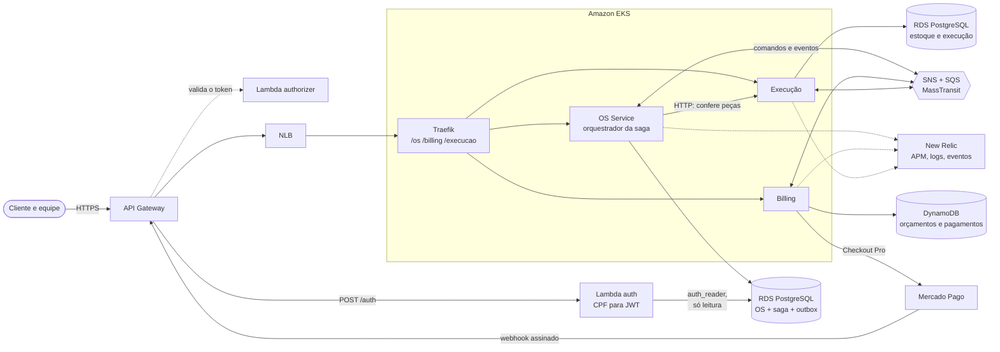
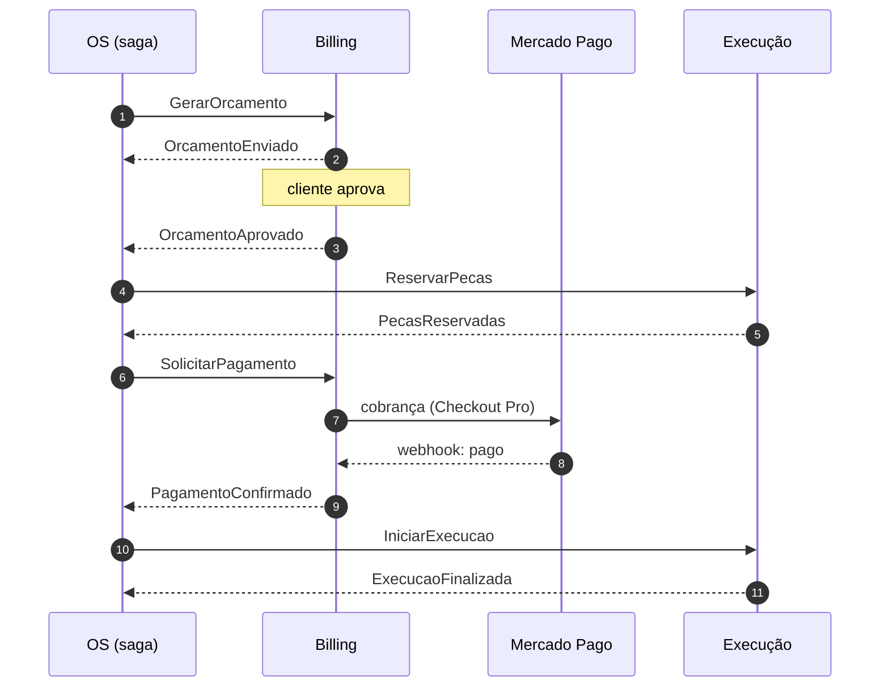
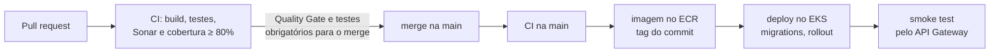

# Arquitetura da Fase 4

O monólito da Fase 3 virou três microsserviços, cada um com seu banco, que se falam por
mensagens. A ordem de serviço atravessa os três numa **saga orquestrada** pelo OS Service.

| Serviço | Dono de | Banco | Repositório |
|---|---|---|---|
| **OS** | Ordem de serviço, clientes, veículos, catálogo de serviços, saga | RDS PostgreSQL | [`garageos-os-service`](https://github.com/TechChallengeFase1/garageos-os-service) |
| **Billing** | Orçamentos e pagamentos (Mercado Pago) | DynamoDB | [`garageos-billing-service`](https://github.com/TechChallengeFase1/garageos-billing-service) |
| **Execução** | Estoque, reserva de peças, execução e aging | RDS PostgreSQL | [`garageos-execucao-service`](https://github.com/TechChallengeFase1/garageos-execucao-service) |

| Infraestrutura | Repositório |
|---|---|
| VPC, OIDC, state do Terraform, segredos compartilhados e o security group dos bancos | [`garageos-infra-database`](https://github.com/TechChallengeFase1/garageos-infra-database) |
| Cluster EKS, nós, Traefik (um NLB para os três), New Relic | [`garageos-infra-k8s`](https://github.com/TechChallengeFase1/garageos-infra-k8s) |
| API Gateway, Lambda de login por CPF e authorizer | [`garageos-lambda-auth`](https://github.com/TechChallengeFase1/garageos-lambda-auth) |

Cada serviço tem o próprio `infra/` (banco, ECR, role IRSA, parâmetros SSM) e o próprio `k8s/`.

## Rotas pelo API Gateway

| Rota | Autenticação | Destino |
|---|---|---|
| `POST /auth` | pública | Lambda: CPF para JWT do cliente |
| `POST /os/api/auth/login` | pública | OS: login de Admin |
| `GET /os/api/ordensdeservico/acompanhar/{numeroOS}` | pública | OS: acompanhamento pelo cliente |
| `POST /billing/api/webhooks/mercadopago` | pública, assinatura `x-signature` | Billing |
| `GET /{servico}/health/ready` | pública | Saúde de cada serviço |
| `ANY /{proxy+}` | JWT, validado pelo authorizer | Traefik, que escolhe o serviço pelo prefixo |

## A saga

Por que orquestrada, os passos e as compensações: [README do OS Service](../README.md#saga-pattern-por-que-orquestração)
e [ADR 0005](adrs/0005-saga-orquestrada.md). Mensageria: [ADR 0006](adrs/0006-mensageria-sqs-masstransit.md).

## Entrega contínua

Com a infra destruída, o deploy é pulado com um aviso, em vez de falhar.

## Observabilidade

Nomes por serviço no New Relic, `correlationId` atravessando as mensagens e o dashboard da saga:
[docs/observabilidade](observabilidade/README.md).
